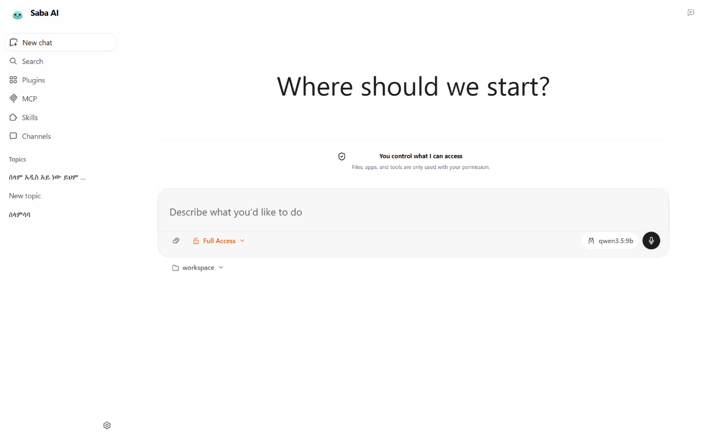
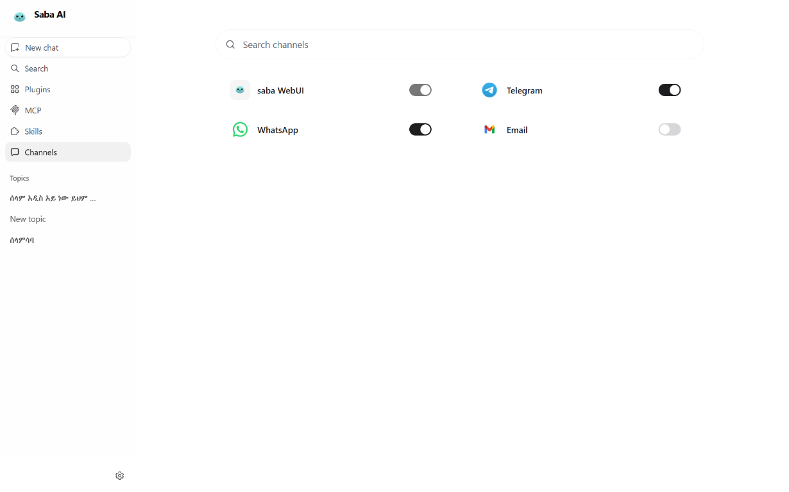
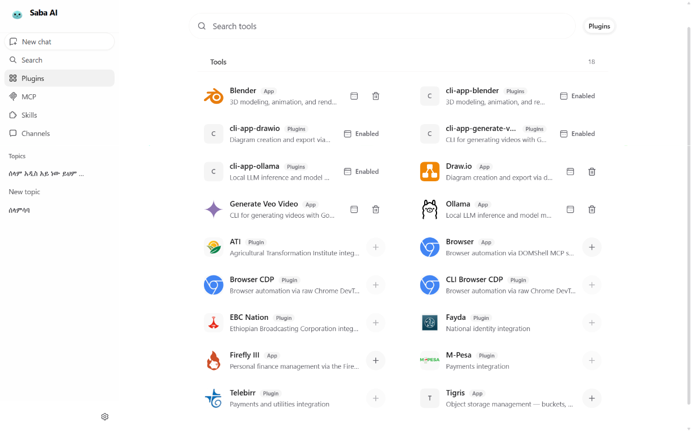

# Saba AI

Saba is a self-hosted AI assistant. It gives you one place to chat with an AI model, work with files, use approved tools, remember useful context, and connect chat channels.

Saba runs on your computer or server. You choose the AI provider, the model, the files it can access, and the tools it can use.

<p align="center">
  
</p>

<p align="center">
  
</p>

## What Saba does

- **Chat:** Start topics in the browser or terminal and continue them later.
- **Work with files:** Read and process documents such as PDF, Word, Excel, and PowerPoint files.
- **Use tools:** Run approved shell, web, MCP, document, and automation tools when enabled.
- **Remember context:** Keep session history and selected long-term preferences.
- **Connect channels:** Use the WebUI, Telegram, WhatsApp, and other supported channels.
- **Use different models:** Configure hosted providers, OpenAI-compatible endpoints, or local model servers.
- **Automate work:** Create scheduled tasks and longer-running goals.
- **Develop and extend:** Add skills, plugins, MCP servers, providers, and channel integrations.

## What Saba does not do automatically

- It does **not** provide an AI model or API key. You must connect a provider or local model.
- It does **not** make every tool safe. Review permissions before enabling shell, browser, file, or external-service tools.
- It does **not** upload all local files by default. File access depends on the workspace and tools you approve.
- It does **not** guarantee that model responses are correct. Check important answers and generated changes.
- It does **not** expose your WebUI safely to the public internet by default. Use authentication and follow the deployment guidance before remote access.
- It does **not** require Node.js or Bun for normal users. They are needed only for WebUI development.

## How it works

1. You send a message from the WebUI, terminal, or a connected channel.
2. Saba sends the message and permitted context to your selected model.
3. The model may request an enabled tool, such as reading a file or searching the web.
4. Saba asks for permission when required, runs the tool, and returns the result to the model.
5. The model produces a response, which Saba shows in the same conversation.

The model is the reasoning service. Saba is the self-hosted application around it: it manages conversations, permissions, tools, channels, memory, and the user interface.

## Screens and architecture

The WebUI includes a chat workspace, channel management, plugin and tool management, skills, and controlled workspace access.

## WebUI screens

### Start a conversation

The home screen lets you start a topic, choose a workspace and model, attach files, and select the access level for the task.

<p align="center">
  
</p>

### Manage channels

The Channels screen lets you see and enable connected interfaces such as the Saba WebUI, Telegram, WhatsApp, and email.

<p align="center">
  
</p>

### Manage plugins and tools

The Plugins screen shows available applications and tools, including browser automation, local model integrations, diagrams, and other extensions.

<p align="center">
  
</p>

## Choose your setup

| Goal | Use |
| --- | --- |
| Just use Saba locally | `uv sync`, then `saba webui` |
| Install without uv | Python virtual environment and `pip install -e .` |
| Change React/TypeScript WebUI code | `bun install`, then `bun run dev` |
| Run in a repeatable container | Docker Compose |
| Test the browser UI | Playwright plus the Chromium install command below |

For most users, use **Quick install with frozen dependencies**. Use the other sections only when you need them.

## Requirements

- Python 3.11 or newer
- Git
- An API key or account for a supported AI model provider
- [uv](https://docs.astral.sh/uv/) for the exact locked Python environment
- Bun only when developing the WebUI
- Docker Desktop only when using Docker

## Quick install with frozen dependencies

Run these commands from the directory containing `pyproject.toml`.

### Windows PowerShell

```powershell
uv sync
.\.venv\Scripts\saba.exe webui
```

### macOS or Linux

```bash
uv sync
./.venv/bin/saba webui
```

`uv sync` uses the committed [`uv.lock`](./uv.lock), so the complete Python dependency graph is reproducible. If `uv` is not installed, install it from the [official guide](https://docs.astral.sh/uv/getting-started/installation/).

The WebUI opens at:

```text
http://127.0.0.1:8765
```

1. Open **Settings → Models**.
2. Create a model preset and enter the provider credentials.
3. Start a new topic and send `Hello!`.

Keep API keys and browser sign-in links private.

## Install with Python and pip

If you do not use `uv`, create a virtual environment and install the project directly from `pyproject.toml`.

### Windows PowerShell

```powershell
py -3.11 -m venv .venv
.\.venv\Scripts\python.exe -m pip install --upgrade pip
.\.venv\Scripts\python.exe -m pip install -e .
.\.venv\Scripts\saba.exe webui
```

### macOS or Linux

```bash
python3.11 -m venv .venv
./.venv/bin/python -m pip install --upgrade pip
./.venv/bin/python -m pip install -e .
./.venv/bin/saba webui
```

The committed [`uv.lock`](./uv.lock) is the dependency freeze. The root [`requirements.txt`](./requirements.txt) is a small compatibility list and is not a replacement for the lockfile.

## Run later

```powershell
# Windows
.\.venv\Scripts\saba.exe webui
```

```bash
# macOS or Linux
./.venv/bin/saba webui
```

Check the installation:

```text
saba --version
saba status
```

## WebUI development and browser tests

The packaged application already contains the built WebUI. Use these commands only when changing frontend code:

```bash
cd webui
bun install
bun run dev
```

For gateway-aware development, run this from the project root:

```bash
saba webui --dev
```

Install the Chromium browser used by Playwright tests:

```bash
cd webui
bun x playwright install chromium
```

Run frontend checks:

```bash
bun run lint
bun run typecheck
bun run test
bun run test:browser
bun run build
```

## Docker Compose

With Docker Desktop running:

```bash
docker compose up --build
```

Open `http://127.0.0.1:8765`. Stop the services with:

```bash
docker compose down
```

- **OpenClaw inspiration and open-source community:** [openclaw/openclaw](https://github.com/openclaw/openclaw)

Saba is released under the MIT License. See [`LICENSE`](./LICENSE) and preserve upstream copyright and license notices when redistributing changes.
